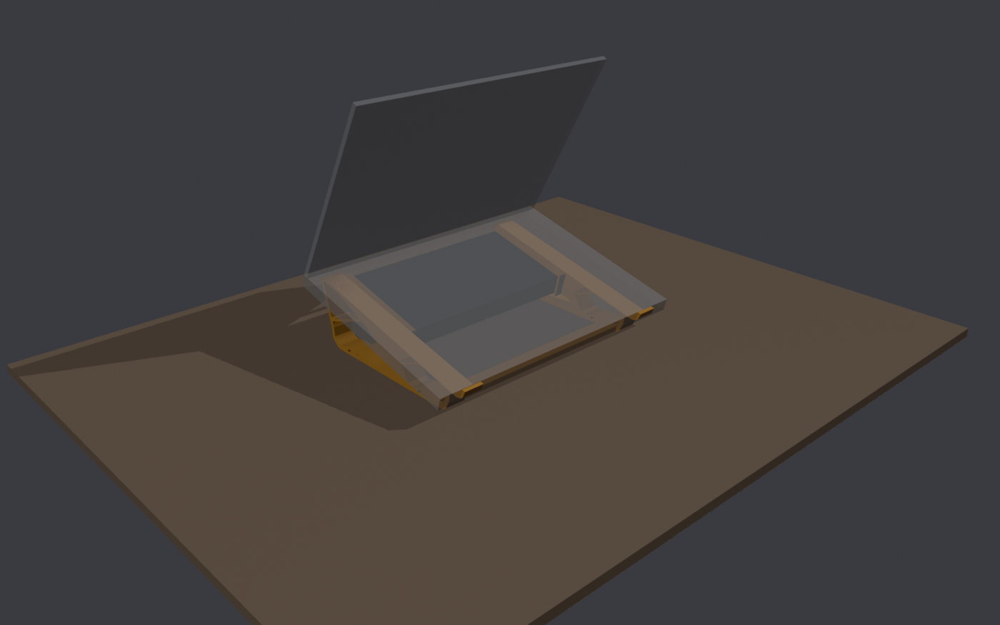
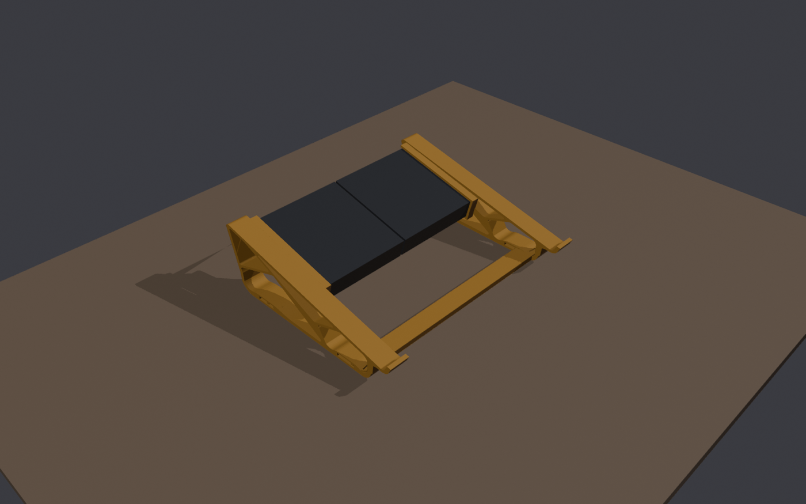
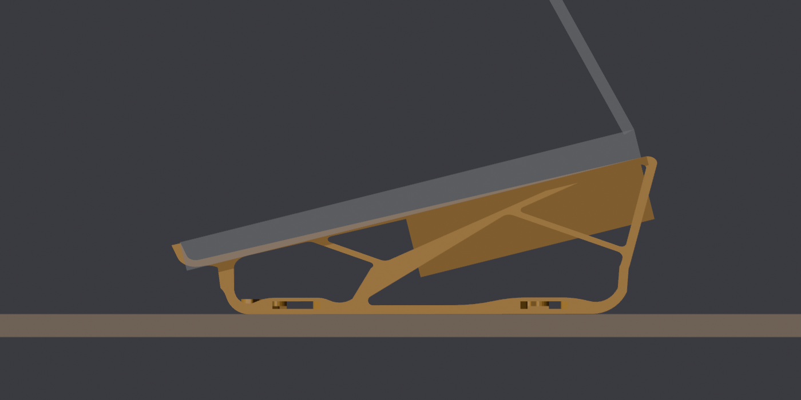

# Laptop Cooling Stand

A tilted laptop stand that holds two 120mm USB fans under the laptop.
Made for an HP OmniBook X Flip 16, and fits most 14–16" laptops.

| | |
|---|---|
| Tilt | 14° (back higher) |
| Laptop height | ~23 mm at the front, ~82 mm at the back |
| Fans | 2 × 120 × 120 × 25 mm ([ELUTENG dual 120mm USB fan](https://www.amazon.com/dp/B0B751T5M5)), sitting ~23 mm above the desk |
| Footprint | 298 × 255 mm |

## Print (Elegoo Centauri Carbon, 256 × 256 mm bed)

The files are already laid flat and rotated diagonally to fit the bed. Load each one as-is: no rotating, no supports.

| File | Qty | Size on the plate |
|---|---|---|
| [`stl/side_LEFT_print_flat.stl`](stl/side_LEFT_print_flat.stl) | 1 | 214 × 187 × 35 mm (fan rail facing up) |
| [`stl/side_RIGHT_print_flat.stl`](stl/side_RIGHT_print_flat.stl) | 1 | 187 × 214 × 35 mm (fan rail facing up) |
| [`stl/crossbar_print_x2.stl`](stl/crossbar_print_x2.stl) | **2** | 224 × 224 × 6 mm (one per plate) |

**Settings:** PETG recommended (it handles laptop heat better than PLA), 0.2 mm layers, 3 walls, 15–20% infill, no supports. A brim on the sides is optional.

## Assemble

1. Clip the two crossbars into the slots at the bottom of both sides.
2. Pull the rubber feet off both fans.
3. Slide one fan into each side's rail **from the back** until it hits the front stop. Run the USB cable out the back.
4. Set the laptop on top, with its front edge against the front hooks.

## Credits and license

The side frames and crossbars are a remix of [Laptop Stand by Tomba](https://www.printables.com/model/1125173-laptop-stand) (CC BY-SA). The remix re-angles the sides from 20° to 14°, raises them 10 mm, widens the stance and adds the fan rails.

This remix is shared under the same license, [CC BY-SA 4.0](https://creativecommons.org/licenses/by-sa/4.0/).
